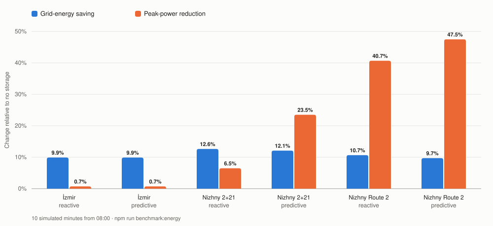

# Experiments and Metrics

## Headless simulation

Run a deterministic scenario without the interface:

```bash
npm run simulate:headless -- \
  --scenario nizhny-routes-2-21 \
  --tram-count 12 \
  --duration-hours 1 \
  --start-minute 480 \
  --sample-seconds 60 \
  --output outputs/nizhny-0800.json
```

The report schema is versioned as `schemaVersion: 1` and contains:

- the core that ran it (`coreRuntime`: `cpp-wasm`, as in the browser, or
  `typescript-fallback`, which does not simulate the traction-power network);
- requested and simulated duration;
- start/end service clock;
- final network metrics;
- route-level operations;
- energy statistics;
- event counts;
- periodic samples.

## Energy comparison

`runEnergyComparison` executes three identical service cases:

1. no wayside storage;
2. reactive flywheel storage;
3. predictive SOC and peak dispatch.

Energy saving is calculated using grid energy per vehicle-kilometre, not raw
grid kWh, so small strategy-dependent distance differences do not bias the
comparison.

```text
grid Wh/vkm = grid supply Wh / simulated vehicle distance km
energy saving = (reference - strategy) / reference · 100%
peak reduction = (reference peak - strategy peak) / reference peak · 100%
```

## Current reproducible benchmark



Ten simulated minutes, service start 08:00. Regenerate the table with
`npm run benchmark:energy`, and the chart with
`npm run benchmark:energy -- --write-chart`:

| Scenario and controller | Grid-energy saving | Peak-power reduction | Notes |
| --- | ---: | ---: | --- |
| İzmir, 14 trams, reactive | 9.9% | 0.7% | Flywheel only, no traction guidance |
| İzmir, 14 trams, predictive | 9.9% | 0.7% | 1 intervention |
| Nizhny 2+21, 12 trams, reactive | 12.6% | 6.5% | Flywheel only, no traction guidance |
| Nizhny 2+21, 12 trams, predictive | 12.1% | 23.5% | 66 interventions |
| Nizhny Route 2, 10 trams, reactive | 10.7% | 40.7% | Flywheel only, no traction guidance |
| Nizhny Route 2, 10 trams, predictive | 9.7% | 47.5% | 52 interventions |

These are simulator outputs, not measured savings for either real operator.

The İzmir peak figures are not a controller result. With a fixed tram count the
comparison ignores the configured fleet groups and starts all 14 trams from one
point in the Alsancak section, so the ten minutes cover a single dispatch wave.
The network peak is the sum of six sections, and no section reaches the 480 kW
threshold (24% of its 2,000 kW substation) above which İzmir flywheels
discharge, so the peak is decided by whether two trams happen to accelerate
together. When stop braking changed, this moved the reactive figure from 24.4%
to 0.7% and the predictive figure from -6.2% to 0.7%. The İzmir energy figures
are unaffected.

The previous figures were 10.6%/24.4%, 10.6%/-6.2%, 10.3%/6.5%, 9.8%/23.5%,
10.5%/40.7% and 8.6%/47.5% (energy saving / peak reduction, same row order).
They changed when trams began braking to stop points instead of stopping in
one step, and when a fully charged flywheel stopped throttling accelerating
trams.

## Service metrics

| Metric | Interpretation |
| --- | --- |
| Mean headway | Average time or route separation between consecutive vehicles |
| Headway CV | Standard deviation divided by mean headway; lower is more regular |
| Departure adherence | Share of planned terminal departures inside the tolerance window |
| Mean departure deviation | Mean absolute timing difference from the reserved slot |
| Average passenger wait | Estimated waiting time from queues and service state |
| Left behind | Passengers remaining because capacity was reached |
| Interventions | Energy-controller changes to vehicle traction guidance |

## Experimental discipline

- Compare one control variable at a time.
- Hold scenario, fleet, service clock and duration constant.
- Report distance-normalized energy and absolute peak power.
- Preserve negative or inconvenient results.
- Repeat future stochastic experiments with disclosed seeds and confidence
  intervals.
- Separate calibration data from validation data.

