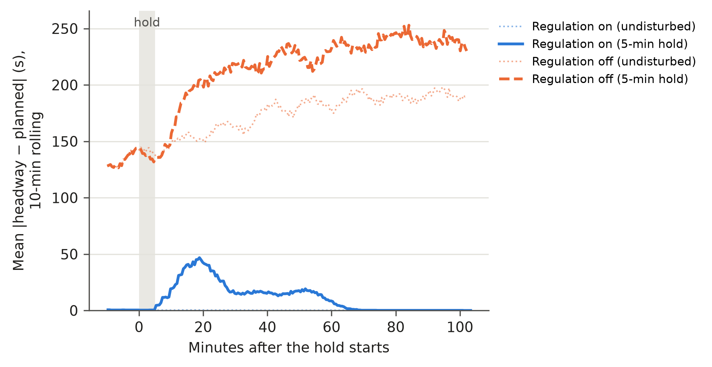
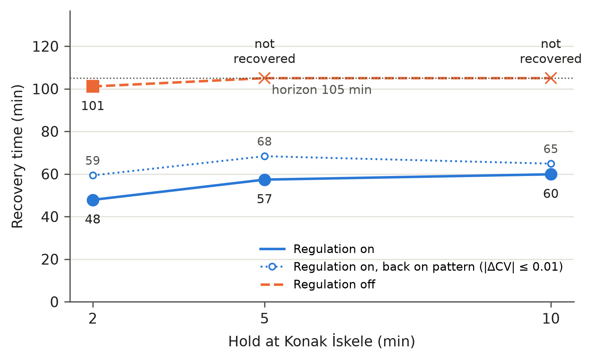
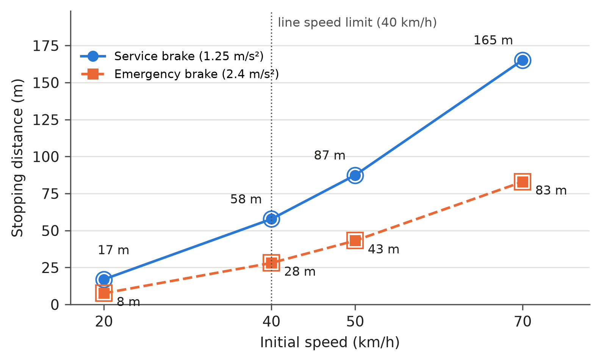

# Preliminary Results

Two sets of results from the deterministic C++/WebAssembly core:
[automation and safety](#part-1-automation-and-safety) (fault injection,
disturbance recovery, braking) and [energy](#part-2-energy) (the wayside
flywheel benchmark of [EXPERIMENTS.md](EXPERIMENTS.md) and its sensitivity
study). All numbers are simulator outputs. The safety results are simulator
checks, not certified signalling; the energy results compare strategies with
each other and are not measured savings for either operator (see
[Limitations](#limitations)).

## How to reproduce

```bash
git checkout main
npm ci                            # Node ≥ 22.13 (results produced with Node v24.19.0)
# Part 1: automation and safety
npm run automation:safety         # outputs/automation/safety-stress.csv, ~15 min on 8 cores
npm run automation:safety -- --ablation   # safety-stress-ablation.csv, each fault type alone, ~20 min
npm run automation:disturbance    # disturbance.csv and disturbance-series.json, ~10 min
npm run automation:braking        # braking.csv, seconds
# Part 2: energy
npm run benchmark:sweeps          # outputs/sweeps/results.csv, ~10 min, resumable
npm run benchmark:sanity          # outputs/sweeps/sanity.json and sanity.md, ~4 min
# Figures 1–7
python3 -m pip install pandas matplotlib
python3 scripts/plot_results.py   # docs/assets/results/fig*.png and .svg
```

Every row records `core_runtime` and `git_commit`, and the scripts stop if the
TypeScript fallback is used. The energy study, the disturbance study and the
braking study are deterministic, so they have no seeds and no
"mean ± std over seeds". The safety stress test injects faults at random times,
so it uses seeds; the seeds (1–8 per network, 0 for the fault-free reference)
are recorded in every row. The data behind this page is committed in
[assets/results](assets/results/): `safety-stress.csv`,
`safety-stress-ablation.csv`, `disturbance.csv`, `disturbance-series.json`,
`braking.csv`, `results.csv` and `izmir-baseline-grid-power.csv`.

One energy case on its own:

```bash
npm run benchmark:case -- --scenario izmir-konak --tram-count 12 --start-minute 1020 \
  --strategy reactive --csv outputs/my-cases.csv
```

Options: `--scenario`, `--tram-count`, `--start-minute`, `--warmup-minutes`,
`--window-minutes`, `--storage-scale` (multiplies every flywheel bank's power
and energy; 0 removes the banks), `--eta-scale` (multiplies charge and
discharge efficiency; a result above 1 is rejected), `--timestep-ms`,
`--strategy none|reactive|predictive` (repeatable or comma-separated),
`--csv`, `--json` (full schemaVersion 2 report) and
`--grid-power-sample-seconds`. Saving and peak reduction are always computed
against a no-storage run with exactly the same other parameters, with the
ΔE-corrected formulas in [EXPERIMENTS.md](EXPERIMENTS.md#energy-comparison).

## Part 1. Automation and safety

These studies add an independent safety oracle, fault and disturbance
injection hooks and two experiment switches (below), all off by default. They
run on the control logic after the liveness fixes described
[below](#liveness-gaps-found-and-fixed): an earlier run of the same stress test
found three gaps that needed an operator to clear, and all numbers on this page
come from the fixed logic (`cddcca2`).

### Safety stress test

Each session runs 4 simulated hours from 07:00 with the configured fleet
(İzmir 14 trams, Nizhny Novgorod Routes 2 + 21 10 trams). After a 10 min
warm-up, faults arrive at random (exponential spacing, mean 60 s):

- **dropped detector**: all entry and clear observations of one signal are
  lost for 5–60 s;
- **duplicate entry**: the next entry observation of a signal is sent twice,
  and the owner's entry is sent again 1–20 s later;
- **wrong-tram clear**: a clear observation for an occupied crossing arrives
  with another tram's identity;
- **missing rear-clear**: clear observations of one signal are lost for
  30–120 s, against clearance timeouts of 25–115 s that scale with each
  crossing's configured length;
- **foreign switch request** (Nizhny only; İzmir has no switches): a switch
  reader reports a tram that is not there, or an operator requests the points.

Detector faults are injected where the browser layer hands observations to the
C++ core, so the core and its TypeScript mirror see exactly what a faulty
detector sends. On every 50 ms step an oracle checks, from vehicle positions
and track geometry rather than from the controllers' own bookkeeping:
collisions (a front inside the body ahead), front-to-front spacing below the
22 m physical minimum (0.5 m tolerance), overtaking, more than one tram in a
junction conflict zone, a tram inside a crossing while road traffic has green
or amber, an entered tram grant under a road phase, and points moving while
locked or under a tram. A lock that lapses before its owner reaches the points
counts as released only if the owner could still stop short of them with the
service brake. The oracle's own tests plant each of these violations and check
that it is counted ([automation.test.mjs](../tests/automation.test.mjs)). It
also times how long trams wait at a junction or at points whose phase or owner
does not change, from the moment the first tram starts waiting.

| Network, 8 seeds × 4 h | Faults injected | Safety violations | Closest spacing | All-red latches per session | Longest recovered latch | Vehicle-km per session | On-time |
| --- | ---: | ---: | ---: | ---: | ---: | ---: | ---: |
| İzmir Konak | 1,820 | **0** | 21.96 m | 7–17 (fault-free 0) | 41–134 s (fault-free: none) | 1,088–1,089 (fault-free 1,088) | 93.0–96.8% (97.2%) |
| Nizhny Routes 2 + 21 | 1,837 | **0** | 25.55 m | 15–24 (fault-free 8) | 73–155 s (fault-free 2 s) | 824–828 (fault-free 828) | 95.4–97.2% (97.2%) |

Every latch recovered by itself, and no junction or points were blocked at the
end of any session. The longest wait at a junction was 80–134 s on İzmir and
53–140 s on Nizhny (fault-free 84 s and 51 s); the longest wait at points was
32–60 s, the lapse time of a phantom approach lock.

Each fault type alone (3 seeds × 4 h per type and network):

| Fault type | İzmir Konak | Nizhny Routes 2 + 21 |
| --- | --- | --- |
| Duplicate entry | no effect: identical to the fault-free run | no effect: identical to the fault-free run |
| Wrong-tram clear | no effect: identical to the fault-free run | no effect: identical to the fault-free run |
| Missing rear-clear | latches 37–45 (fault-free 0), longest 209–477 s; vehicle-km −0.1 to −2.4% | latches 44–57 (fault-free 8), longest 233–343 s; vehicle-km −1.2 to −3.6% |
| Dropped detector | 1–3 latches, longest 39 s; no service effect | 1–4 more latches, longest 50 s; vehicle-km 0.0 to +0.5% |
| Foreign switch request | not applicable | no service effect: each phantom approach lock lapses after 60 s |

In all 45 sessions (about 9,900 faults over 172 faulted simulated hours plus
two fault-free references) the oracle found **no safety violation**: no
collision, overtaking, conflict-zone or crossing violation, exposed grant or
points moved while locked. The closest front-to-front spacing was 21.57 m
(missing rear-clear on İzmir), 0.43 m inside the 22 m physical minimum and
within the oracle's tolerance; bodies stayed 6.6 m apart. Duplicate entries and
wrong-tram clears are rejected by the core outright. A missing rear-clear
latches all-red, as specified, and the crossing reopens once the clear is
observed; in seed 1 on each network one such latch was still open when the
4 h session ended. A lost entry is re-reported from the owner's odometer once
the detector works again, so a dropped detector costs at most a short latch.

#### Liveness gaps found and fixed

The first run of this stress test (`a034f20`) found three **liveness gaps**.
They were fail-safe, since every affected movement stayed at red, but none
recovered without an operator:

1. **Stale crossing grant.** When the entry of the tram holding a crossing grant
   was lost while it passed, the crossing stayed reserved for a tram that had
   gone (dropped detector: Nizhny vehicle-km −66 to −92%, İzmir −75% in one
   seed). The browser now records the owner's passage from its odometer and
   re-reports the entry, and the rear clear once the odometer puts the rear past
   the crossing. The core still requires an entry before any clear.
2. **Stale switch lock.** A spurious switch request locked the points for a
   tram that was not coming, and the Nizhny network deadlocked (foreign switch
   request: vehicle-km −91 to −93%). An approach lock now lapses after 60 s
   while its owner is not past, over or within braking distance of the points.
   The lapse never moves the points, and passage itself needs the lock.
3. **No keep-clear check.** Even without faults, an İzmir tram queueing for the
   full Fahrettin Altay terminal stopped inside the Üçkuyular road crossing and
   latched it all-red until the terminal freed up. A tram now enters a crossing
   only if it can clear it, past a stopped leader or into a terminal with a free
   platform. While it waits at the stop line it gives back any grant, and a
   grant goes only to the first tram in line on its approach.

In the same run the 25 s clearance timeout also expired about 30 times per hour
in normal service on İzmir, mostly at Konak and Gazi, and 89 times in 4 h on
Nizhny: several configured crossing zones are 90–270 m long, which a tram
approaching the stop beyond them cannot clear in 25 s. The timeout now scales
with the zone (at least 25 s, otherwise the zone plus one tram length at
2.5 m/s). The fault-free İzmir run now has no latch at all; the fault-free
Nizhny run has 8, each cleared within 2.3 s by a tram crossing slightly slower
than 2.5 m/s.

### Disturbance recovery

İzmir, configured fleet of 14 trams, evening peak (planned headway 4.6 min).
Service starts at 16:30; after a 70 min warm-up one tram is held at Konak
İskele (towards Fahrettin Altay) for 2, 5 or 10 min, or 250 extra passengers
arrive there, and the run continues for 105 min, all inside one timetable
window. Regulation means terminal holding (timetable slots and interval holds
at the terminals) plus en-route interval restoration (speed reduction when a
tram closes on its leader). Both are switched off through two experiment
switches, `terminalHolding` and `intervalRestoration`, which do not relax
separation: the 30 m safety headway, the no-passing lock and signal protection
stay active. The engine's older `collisionAvoidance=false` would also lower the
safety headway to the 22 m physical minimum, so it is not used. Every run is
checked by the safety oracle: **0 violations** in all 14 runs, closest spacing
22.01 m.

Headways come from the exact departure times of every stop. Recovery time runs
from the start of the disturbance to the moment after which, until the end of
the run, the 10-min rolling headway CV stays within 0.10 of the undisturbed run
with the same regulation (headway spread within 10% of the mean headway) and the
10-min rolling on-time share stays within 10% of it. Back on pattern uses the
stricter |ΔCV| ≤ 0.01. A band of 10% *of* the CV cannot be used, because the
regulated line runs at CV ≈ 0.001, where that band is narrower than rounding.

Undisturbed, 17:40–19:25:

| Regulation | Headway CV | Mean \|headway − planned\| | Longest gap | Busiest-stop wait | On-time |
| --- | ---: | ---: | ---: | ---: | ---: |
| On | 0.001 | 0 s | 277 s | 420 s | 100% |
| Terminal holding off | 0.086 | 54 s | 328 s | 397 s | 100% |
| Interval restoration off | 0.001 | 0 s | 277 s | 421 s | 100% |
| Off | 0.912 | 174 s | 794 s | 883 s | 85.7% |

Disturbed, compared with the undisturbed run of the same regulation:

| Disturbance | Regulation | Recovery | Back on pattern | Longest gap | Shortest headway | Wait change | Left behind |
| --- | --- | ---: | ---: | ---: | ---: | ---: | ---: |
| Hold 2 min | on | 48 min | 59 min | 390 s | 172 s | +22 s | 0 |
| Hold 2 min | off | 101 min¹ | not reached | 889 s | 0 s | +138 s | 0 |
| Hold 5 min | on | 57 min | 68 min | 586 s | 108 s | +51 s | 0 |
| Hold 5 min | off | not within 105 min | not reached | 1,118 s | 1 s | +430 s | +17 |
| Hold 5 min | terminal holding off | not within 105 min | not reached | 540 s | 99 s | +160 s | 0 |
| Hold 5 min | interval restoration off | 28 min | 32 min | 589 s | 24 s | +41 s | 0 |
| Hold 10 min | on | 60 min | 65 min | 915 s | 65 s | +189 s | 0 |
| Hold 10 min | off | not within 105 min | not reached | 1,447 s | 1 s | +920 s | +136 |
| 250-passenger surge | on | within band throughout | 39 min | 311 s | 246 s | +554 s | +301 |
| 250-passenger surge | off | within band throughout | not reached | 746 s | 20 s | +393 s | +353 |

¹ Reached 4 min before the end of the run, against an unregulated reference
that is itself drifting; not a meaningful recovery.

- **Regulation keeps the line regular.** With regulation on, the undisturbed
  line runs exactly to the planned 4.6 min headway (CV 0.001). With it off, the
  line bunches by itself (CV 0.91, growing from 0.70 to 1.00 over the window),
  trams leave stops as little as 5 s apart, and the busiest-stop wait is 2.1
  times longer.
- **A hold is absorbed within one cycle.** With regulation on, a 2, 5 or 10 min
  hold is back within the recovery band after 48, 57 and 60 min and back on the
  exact pattern after 59–68 min, about one round trip, with no passenger left
  behind. With regulation off, the line does not recover from a 5 or 10 min
  hold within 105 min; the gaps grow to 19 and 24 min and full trams leave 17
  and 136 passengers behind.
- **Terminal holding does the recovery; interval restoration slows it.** With
  terminal holding off, a 5 min hold never recovers. With interval restoration
  off, it recovers in 28 min instead of 57 min, because restoration slows the
  trams closing up behind the gap and spreads the delay over more of them; the
  price is closer bunching on the way (shortest headway 24 s against 108 s).
- **A passenger surge** costs waiting time (+554 s at the busiest stop) and
  leaves 301 passengers behind, but barely disturbs the headways: the 45 s
  maximum dwell caps how long a crowded stop can hold a tram.
- **On-time share is a weak metric here.** It counts trams more than 60 s late
  on their interval; on a bunched line only the platoon leaders count, so it
  stays at 85.7% while the headway CV doubles. The headway CV and the gaps are
  the informative measures.



**Figure 5.** Mean absolute deviation of stop headways from the planned 4.6 min
(10-min rolling) after one tram is held 5 min at Konak İskele, with regulation
on and off; dotted lines are the undisturbed runs. With regulation on, the
undisturbed line deviates by 0 s and the held line returns to it after about an
hour; with regulation off, the undisturbed line is itself bunched and the hold
makes it worse.



**Figure 6.** Recovery time against the length of the hold, with regulation on
(solid; dotted: back on the exact headway pattern) and off. Crosses at the
horizon mark runs that did not recover within 105 min; the regulation-off value
for the 2 min hold is not a meaningful recovery (see footnote ¹).

### Braking

Stopping distance of the vehicle model on level track, from steady cruise to
standstill, computed by the C++ vehicle authority at the 50 ms control step.
No driver or system reaction time is included. The service brake tracks a zero
target with a 1.4 s time constant below 1.75 m/s, so the stop is counted at
0.1 m/s (at most 0.14 m before rest).

| Initial speed | Service brake | Emergency brake | Time to stop (service / emergency) | Closed-form check (service / emergency) |
| ---: | ---: | ---: | ---: | ---: |
| 20 km/h | 17.0 m | 7.6 m | 7.7 / 2.5 s | 16.1 / 7.7 m |
| 40 km/h | 57.8 m | 28.1 m | 12.1 / 4.9 s | 57.0 / 28.4 m |
| 50 km/h | 87.4 m | 43.2 m | 14.4 / 6.0 s | 86.7 / 43.5 m |
| 70 km/h | 165.2 m | 82.9 m | 18.8 / 8.3 s | 164.6 / 83.4 m |

- **Limits hold.** The deceleration never exceeds 1.25 m/s² (service) or
  2.4 m/s² (emergency), and its build-up never exceeds the 0.9 m/s³ comfort
  jerk (service) or 5 m/s³ (emergency, when the track brakes apply), in all 16
  cases.
- **Load does not change the distance.** The model commands a deceleration, and
  the brakes reach it at both loads. A full tram (110 passengers, 35.75 t)
  needs 43.2 kN of the 52 kN service brake and, in an emergency, 84.4 kN of the
  88 kN wheel and track brakes (96%); empty, 33.2 and 64.9 kN. Load therefore
  changes how much of the brake force is used, not the stopping distance.
- **The closed-form check** (jerk-limited ramp to constant deceleration) agrees
  within 1 m; service braking is slightly longer because of the speed-tracking
  tail.
- The line speed limit is 40 km/h by default; 50 and 70 km/h are vehicle-model
  cases. Stops in service are planned on a gentler 0.72 m/s² approach envelope,
  so these service distances are the vehicle's capability, not its normal stop.



**Figure 7.** Stopping distance against initial speed for service and emergency
braking; filled markers empty, open markers full (110 passengers), which
coincide.

## Part 2. Energy

### Baseline

Each network's default fleet, service from 08:00, 10 min warm-up, 60 min
measured window, configured storage, 50 ms step. This reproduces the
[EXPERIMENTS.md](EXPERIMENTS.md#current-reproducible-benchmark) table exactly.

| Network, fleet | Strategy | Grid Wh/vkm | Energy saving | Peak kW | Peak reduction | 15-min peak kW | 15-min peak reduction | On-time | Interventions |
| --- | --- | ---: | ---: | ---: | ---: | ---: | ---: | ---: | ---: |
| İzmir Konak, 14 | none | 1349.3 | — | 1500.7 | — | 440.6 | — | 89.4% | 0 |
| İzmir Konak, 14 | reactive | 1052.5 | 22.0% | 1314.8 | 12.4% | 341.1 | 22.6% | 89.4% | 0 |
| İzmir Konak, 14 | predictive | 1052.5 | 22.0% | 1314.8 | 12.4% | 341.1 | 22.6% | 89.4% | 0 |
| Nizhny Route 2, 10 | none | 1353.2 | — | 1487.2 | — | 367.5 | — | 91.2% | 0 |
| Nizhny Route 2, 10 | reactive | 1029.9 | 23.9% | 949.3 | 36.2% | 277.7 | 24.5% | 91.2% | 0 |
| Nizhny Route 2, 10 | predictive | 1029.9 | 23.9% | 949.3 | 36.2% | 277.7 | 24.5% | 91.2% | 0 |
| Nizhny Routes 2+21, 10 | none | 1507.2 | — | 1216.4 | — | 407.6 | — | 90.0% | 0 |
| Nizhny Routes 2+21, 10 | reactive | 1158.7 | 23.1% | 1110.5 | 8.7% | 309.1 | 24.2% | 90.0% | 0 |
| Nizhny Routes 2+21, 10 | predictive | 1158.7 | 23.1% | 1110.5 | 8.7% | 309.1 | 24.2% | 90.0% | 0 |

Peak kW is the highest network grid power at any single 50 ms step of the
window. 15-min peak kW is the highest mean network grid power over any 15 min
interval inside the window, from the core's per-step grid-energy integral
(metered supply, no ΔE correction); 15 min is a common averaging interval
for billed demand. On-time is the time mean of the share of in-service trams within ±60 s of
their interval (`onTimePercent`), sampled every 60 s without disturbing the run.
The predictive rows are identical to the reactive ones: its traction guidance
never intervenes in the baseline windows (see
[Predictive against reactive](#sensitivity)).

### Sensitivity

One factor at a time around the baseline; 25 distinct cases × 3 strategies.

- **Time of day** (06:00, 08:00, 12:00, 17:00, 21:00). Reactive energy saving
  ranges from 22.0% to 24.1% on İzmir, 23.8% to 24.3% on Nizhny Route 2 and
  21.5% to 23.1% on Nizhny 2+21, while its peak reduction ranges much more
  widely: 4.2% to 14.2%, 17.4% to 36.2% and 8.7% to 30.5%.
- **Fleet size** (İzmir, 8–16 trams). Reactive saving falls from 25.1% with 8
  trams to 21.2% with 16, because more trams reuse each other's braking energy
  directly and leave less for storage; peak reduction varies non-monotonically
  between 3.3% and 20.5%. Above 12 trams the terminal headway stays at about
  4.6 min: the timetable, not the fleet, sets it.
- **Storage size** (İzmir, 0, 0.5, 1.0, 1.5 × the configured banks). Reactive
  saving rises from 0% to 15.0%, 22.0% and 25.2%, with diminishing returns.
  Peak reduction is 12.4% at every size from 0.5 to 1.5: the reactive rule only
  discharges above a fixed per-section grid setpoint (24% of substation rating,
  at most 420 kW), and at the window peak two sections sit at that setpoint with
  their flywheels 71–79% charged. The peak is set by the dispatch rule, not by
  the stored energy.
- **Efficiency** (İzmir, η scale 0.9, 0.95, 1.0 of the nominal 0.95 per
  direction, i.e. η = 0.855, 0.9025, 0.95). Reactive saving is 18.7%, 20.3% and
  22.0%; the peak reduction does not change.
- **15-min rolling-average peak.** Averaged over 15 minutes, the reactive
  peak reduction follows the energy saving rather than the single-step peak:
  17.2–24.8% across time of day and fleet size on all three networks, and
  15.1%, 22.6% and 26.0% at 0.5×, 1.0× and 1.5× storage. Over 15 minutes the
  flywheels lower grid draw by reusing braking energy, and a bank of
  0.5 kWh modules is far too small to shift demand between intervals. The flat
  12.4% under storage size therefore applies to the single-step peak only: it
  shows that the dispatch setpoint limits how far short demand spikes are
  shaved, not that storage has no effect on averaged demand.
- **Predictive against reactive.** The predictive strategy is the reactive
  flywheel logic plus one traction-guidance rule: when a section draws more
  than its grid setpoint, accelerating trams are limited. With storage
  installed the flywheels already hold each section at that setpoint, so the
  rule almost never acts. In 24 of the 25 cases it intervenes 0 to 6 times per
  hour and the result equals reactive within 0.001 points of energy saving and
  0.05 points of peak reduction. Only with no storage installed does it act
  (165 interventions): it cuts the İzmir peak by 4.8% at an energy cost of
  0.04%, with no change in on-time share; its 15-min peak is 0.2% higher than
  without guidance, so it moves demand in time rather than removing it. The
  predictive strategy therefore provides no benefit over reactive flywheels.
- **Service.** Neither storage strategy changes any service metric:
  trajectories, vehicle-km, on-time share and waits are identical to the
  no-storage run in every case.

### Sanity checks

İzmir baseline, all strategies. Target < 1% for each item. Regenerate with
`npm run benchmark:sanity`.

| Check | Result | Detail |
| --- | --- | --- |
| 1. Energy balance: grid + accepted regen = vehicle demand + flywheel losses + ΔE | pass | Residual ≤ 3.2·10⁻¹² kWh (≤ 6.4·10⁻¹³ %) for all three strategies |
| 2. Timestep 50 ms → 25 ms | **fail** (peak only) | Wh/vkm ≤ 0.11%, 15-min peak ≤ 0.17%, but peak +1.0 to +1.2% (no storage 1500.7 → 1515.9 kW); saving 22.0% → 21.9%, peak reduction 12.4% → 12.2% (reactive) |
| 3a. Warm-up 10 → 20 min (window moves to 08:20–09:20) | **fail** | Wh/vkm +1.6 to +2.1%; peak and 15-min peak unchanged; saving 22.0% → 22.4% |
| 3b. Warm-up 10 → 20 min, same 08:10–09:10 window | **fail** | Wh/vkm +0.58 to +0.74% (within target), but peak +12.8 to +14.6% (no storage 1500.7 → 1692.7 kW); peak reduction 12.4% → 11.0% (reactive and predictive) |
| 3b. Same comparison, 15-min peak | **fail** | 15-min peak +2.9 to +4.4% (no storage 440.6 → 453.5 kW, reactive 341.1 → 356.2 kW); 15-min peak reduction 22.6% → 21.5% |

What these mean:

1. The closure is an identity of the core's bookkeeping. It shows that no
   energy is lost or created between the vehicle, section and flywheel
   counters. It does not validate the physical model.
2. The 50 ms step is converged for energy and the 15-min peak. The
   instantaneous peak moves by 1.0–1.2% at 25 ms, just above the 1% target
   (0.65–0.86% before the liveness fixes): as a single-step maximum it depends
   on exactly when trams accelerate together.
3. Energy per vehicle-km is robust to the warm-up: in 3a the extra 2% comes from
   measuring a later hour, and with the window held fixed (3b) the change is
   0.8%. The **peak is not**: it is the maximum of a single instant, and starting
   the fleet 10 minutes earlier changes how trams are phased when they
   accelerate together. In this one comparison the absolute peak moved by
   13–15% and the peak reduction by 1.4 points, so peak figures on this page
   are indicative, and peak differences of a few points between strategies or
   cases are not significant. The 15-min peak is about three times less
   sensitive (2.9–4.4%) but still misses the 1% target, and its reduction moves
   by 1.1 points, so it is the more robust peak metric, not a converged one.

Grid energy per vehicle-km against published values (column to be completed
from the literature):

| Network | Strategy | Simulated Wh/vkm | Published reference (to fill in) |
| --- | --- | ---: | --- |
| İzmir Konak | none | 1349.3 | |
| İzmir Konak | reactive | 1052.5 | |
| İzmir Konak | predictive | 1052.5 | |

### Energy figures

Each figure is also available as SVG next to the PNG.


**Figure 1.** Grid-energy saving, 15-min peak reduction (highest 15 min mean
grid power) and instantaneous peak reduction (highest 50 ms grid power) of
reactive flywheels against no storage, baseline case on each network. The
15-min peak falls about as much as energy; the instantaneous peak reduction
varies from 8.7% to 36.2% between networks.²


**Figure 2.** İzmir network grid power over the 08:10–09:10 measured window
(a) and a 5 min zoom around the no-storage peak (b), with and without reactive
flywheels; curves are 1 s samples, horizontal lines are each run's window peak
recorded at the 50 ms step.


**Figure 3.** Grid-energy saving against İzmir fleet size, with the measured
mean terminal headway under each fleet size; above 12 trams the timetable, not
the fleet, sets the headway.²


**Figure 4.** Reactive grid-energy saving, 15-min peak reduction and
instantaneous peak reduction on İzmir against flywheel storage size, as a
multiple of the configured banks (power and energy scaled together). Energy
saving and the 15-min peak reduction rise together with storage (15.1%, 22.6%,
26.0% for the 15-min peak), while the instantaneous peak reduction stays at
12.4% from 0.5× to 1.5×: the fixed per-section discharge setpoint, not the
stored energy, limits how far short demand spikes are shaved.²

² The rule-based predictive variant equals reactive in these cases (see
[Sensitivity](#sensitivity)), so it is not drawn.

## Automation ↔ energy link

The two parts meet in the speed profile. Automatic train operation decides how
hard each tram accelerates, how fast it cruises, when it coasts and how long it
dwells; the flywheel dispatch decides when braking energy is stored and when it
is returned to the line. Today they are separate rules: the speed profile only
follows the timetable and the regulation holds, and the dispatch only follows
each section's grid setpoint. The results show what that separation costs. The
instantaneous peak is fixed by the setpoint, not by the storage size; the
energy left to win is mostly rejected braking energy and flywheel losses, which
depend on when trams brake and accelerate relative to each other; and every
change to a speed profile or dwell also moves headways and punctuality, which
regulation restores only over a full cycle. Treated as one multi-objective
problem, with speed profiles (ATO) and flywheel dispatch as joint decision
variables and energy, instantaneous and 15-min peak power and punctuality as
objectives, an NSGA-II/III search can show the trade-offs among the three
that the current separate rules cannot reach. The safety oracle and the
disturbance study above are the constraints and test cases such an optimiser
would have to pass before hardware-in-the-loop (HIL) verification.

## Limitations

Automation and safety:

- **Simulator checks, not certified signalling.** The oracle is independent of
  the controllers' bookkeeping but uses the same geometry and detector model.
  Faults are injected where observations enter the core; there is no detector
  physics, communication delay, message loss between subsystems or safety
  integrity (SIL) analysis. Finding no violation in 172 faulted hours is
  evidence, not proof: formal verification is out of scope.
- **Liveness is tested, not proven.** The three gaps of the first run are fixed
  and no session now needs an operator, but these are the fault types and
  seeds that were run. The 60 s approach-lock lapse, the 2.5 m/s crossing
  traversal speed and the keep-clear distances are design assumptions, and
  several configured crossing zones (90–270 m) are much longer than a real
  road crossing.
- **Narrow disturbance scope.** One network (İzmir), one timetable window (the
  evening peak), one stop and one fleet size. The regulation-off reference is
  itself unstable, and the on-time share does not reflect bunching.
- **Braking on level track only**, without reaction time, adhesion limits (wet
  rail) or gradients. A full tram uses 96% of the available emergency brake
  force on level track, so a downgrade would exceed it; that case is not
  tested. The jump in deceleration at the instant of standstill is not jerk
  limited.

Energy:

- **Comparative, not calibrated.** The vehicle, resistance, auxiliary and
  flywheel parameters are not calibrated against Hyundai Rotem fleet data for
  İzmir or against measurements from the Konak T2 line; five İzmir substation
  positions and the Nizhny feeder boundaries are reconstructed
  ([DATA_AND_ASSUMPTIONS.md](DATA_AND_ASSUMPTIONS.md)). Absolute Wh/vkm and kW
  should not be quoted as real consumption. Auxiliary load is a constant 4.5 kW
  per tram (no seasonal heating or cooling), which keeps absolute Wh/vkm low.
- **No electrical network model.** There is no cable or rail resistance, no
  voltage sag and no DC load flow. Regenerated energy is shared within a
  section without losses or voltage limits, which favours both direct reuse and
  storage.
- **The predictive controller is not a benefit.** Its traction guidance has
  no measurable effect while flywheels are installed, and its SOC and forecast
  dispatch also runs in the reactive strategy, so the two strategies differ
  only by that guidance rule. Earlier versions of this page reported
  predictive differences of up to ±10 points in peak reduction. They came from
  two errors in the guidance threshold, fixed in `f2e75e0`: the rule
  throttled trams while a flywheel was holding the grid exactly at the
  threshold (a floating-point tie), and a cap undid the raised threshold for
  depleted flywheels.
- **Peaks depend on fleet phasing.** The instantaneous peak (highest 50 ms
  grid power) moves by 13–15% when only the warm-up changes (sanity
  check 3b) and by 1.0–1.2% when only the timestep is halved (check 2). The
  15-min peak is less sensitive (2.9–4.4% in check 3b) but still above the
  1% target, so both peak figures are indicative.
- **Service metrics are model metrics.** Terminal holding makes the İzmir
  terminal headway CV close to zero by construction; Nizhny Route 2 has no
  dispatch-controlled terminal, so no headway CV or departure adherence is
  reported there. Waits are a Little's-law estimate at each route's busiest
  stop under synthetic demand.

## Ön Bulgular (2209-A)

Geliştirilen deterministik dijital ikizde (C++17 çekirdek, WebAssembly) önce
otomasyon ve güvenlik işlevleri sınanmıştır. İzmir Konak ve Nijniy Novgorod
2+21 hatlarında, 172 saatlik arızalı oturumda yaklaşık 9.900 tohumlu dedektör
ve makas arızası altında bağımsız bir denetleyici çarpışma, takip mesafesi,
sollama, hemzemin geçit veya kilitli makas ihlali saptamamıştır. İlk denemede
kaçırılan giriş algılaması ve yabancı makas talebinin yol açtığı güvenli fakat
kendiliğinden çözülmeyen kilitlenmeler giderilmiş; düzeltilmiş mantıkla hiçbir
oturum operatör müdahalesi gerektirmemiştir. İzmir'de bir tramvay 2–10 dakika
bekletildiğinde aralık düzenlemesi seferleri 48–60 dakikada yeniden düzene
sokmuş; düzenleme kapalıyken hat kendiliğinden yığılmış ve en yoğun duraktaki
bekleme süresi 2,1 katına çıkmıştır. Acil frenleme 2,4 m/s² sınırını aşmamış,
40 km/sa hızdan durma mesafesi 28 m bulunmuştur. Enerji tarafında reaktif volan
depolama, araç-km başına şebeke enerjisini İzmir'de %22,0, Nijniy hatlarında
%23,1–23,9, İzmir'de 15 dakikalık ortalama tepe talebi %22,6 azaltmış; anlık
tepe güç azaltımı ise depolama kapasitesinden bağımsız olarak %12,4'te
kalmıştır. Hız profillerinin (ATO) ve volan dağıtımının enerji, tepe güç ve
dakiklik için tek bir NSGA-II/III problemi olarak birlikte eniyilenmesi ve
Donanım-Döngüde (HIL) doğrulanması bu çalışmanın araştırma boşluğunu
oluşturmaktadır. Sonuçlar simülatör denetimleridir; sertifikalı sinyalizasyon
veya kalibre edilmiş işletme ölçümü yerine geçmez.
