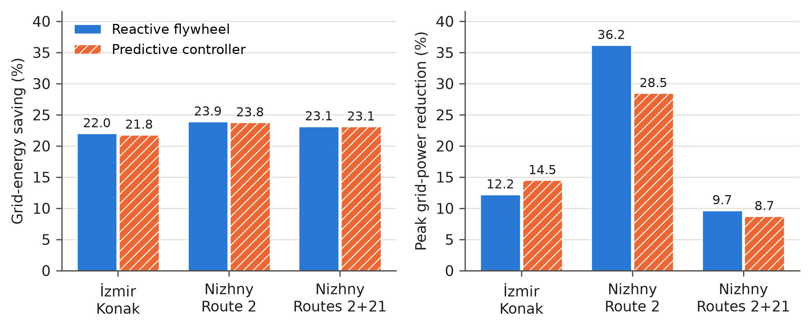
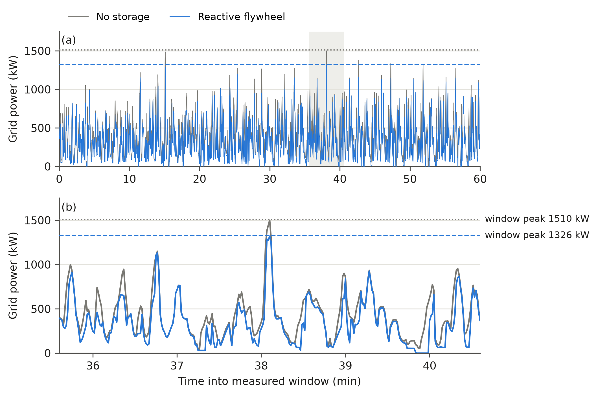
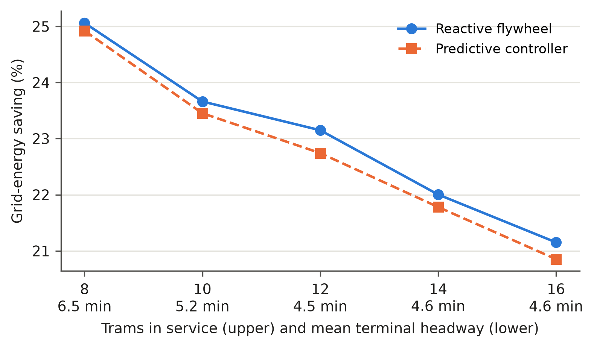
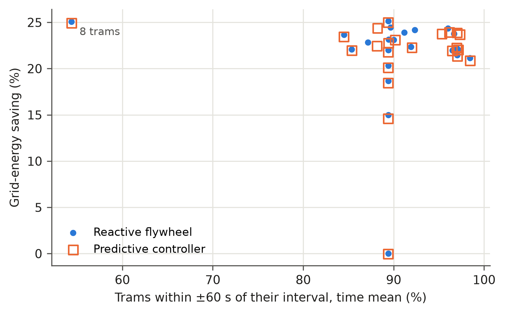

# Preliminary Results

Sensitivity study of the wayside flywheel benchmark in
[EXPERIMENTS.md](EXPERIMENTS.md). All numbers are simulator outputs from the
deterministic C++/WebAssembly core. They compare strategies with each other and
are not measured savings for either operator (see [Limitations](#limitations)).

## How to reproduce

```bash
git checkout results/sensitivity-sweeps   # results.csv rows record git_commit 1aeb765 (same models)
npm ci                        # Node ≥ 22.13 (results produced with Node v24.19.0)
npm run benchmark:sweeps      # outputs/sweeps/results.csv, ~10 min on 8 cores, resumable
npm run benchmark:sanity      # outputs/sweeps/sanity.json and sanity.md, ~4 min
python3 -m pip install pandas matplotlib
python3 scripts/plot_results.py   # docs/assets/results/fig*.png and .svg
```

One case on its own:

```bash
npm run benchmark:case -- --scenario izmir-konak --tram-count 12 --start-minute 1020 \
  --strategy reactive --csv outputs/my-cases.csv
```

Options: `--scenario`, `--tram-count`, `--start-minute`, `--warmup-minutes`,
`--window-minutes`, `--storage-scale` (multiplies every flywheel bank's power
and energy; 0 removes the banks), `--eta-scale` (multiplies charge and
discharge efficiency; a result above 1 is rejected), `--timestep-ms`,
`--strategy none|reactive|predictive` (repeatable or comma-separated),
`--csv`, `--json` (full schemaVersion 2 report) and
`--grid-power-sample-seconds`. Saving and peak reduction are always computed
against a no-storage run with exactly the same other parameters, with the
ΔE-corrected formulas in [EXPERIMENTS.md](EXPERIMENTS.md#energy-comparison).
Every row records `core_runtime` and `git_commit`; the scripts stop if the
TypeScript fallback (which has no traction-power network) is used.

The simulator is deterministic, so there are no seeds and no
"mean ± std over seeds". Variation is explored only through the one-factor
sweeps below. The data behind this page is committed as
[results.csv](assets/results/results.csv) and
[izmir-baseline-grid-power.csv](assets/results/izmir-baseline-grid-power.csv).

## Baseline

Each network's default fleet, service from 08:00, 10 min warm-up, 60 min
measured window, configured storage, 50 ms step. This reproduces the
[EXPERIMENTS.md](EXPERIMENTS.md#current-reproducible-benchmark) table exactly.

| Network, fleet | Strategy | Grid Wh/vkm | Energy saving | Peak kW | Peak reduction | On-time | Interventions |
| --- | --- | ---: | ---: | ---: | ---: | ---: | ---: |
| İzmir Konak, 14 | none | 1348.7 | — | 1509.7 | — | 89.4% | 0 |
| İzmir Konak, 14 | reactive | 1051.9 | 22.0% | 1325.5 | 12.2% | 89.4% | 0 |
| İzmir Konak, 14 | predictive | 1054.9 | 21.8% | 1291.1 | 14.5% | 89.4% | 166 |
| Nizhny Route 2, 10 | none | 1353.2 | — | 1487.2 | — | 91.2% | 0 |
| Nizhny Route 2, 10 | reactive | 1029.9 | 23.9% | 949.3 | 36.2% | 91.2% | 0 |
| Nizhny Route 2, 10 | predictive | 1031.8 | 23.8% | 1064.1 | 28.5% | 95.3% | 127 |
| Nizhny Routes 2+21, 10 | none | 1507.2 | — | 1229.2 | — | 90.0% | 0 |
| Nizhny Routes 2+21, 10 | reactive | 1158.8 | 23.1% | 1110.5 | 9.7% | 90.0% | 0 |
| Nizhny Routes 2+21, 10 | predictive | 1159.2 | 23.1% | 1122.2 | 8.7% | 90.2% | 89 |

On-time is the time mean of the share of in-service trams within ±60 s of
their interval (`onTimePercent`), sampled every 60 s without disturbing the run.

## Sensitivity

One factor at a time around the baseline; 25 distinct cases × 3 strategies.

- **Time of day** (06:00, 08:00, 12:00, 17:00, 21:00). Reactive energy saving
  ranges from 22.0% to 24.5% on İzmir, 23.8% to 24.3% on Nizhny Route 2 and
  21.5% to 23.1% on Nizhny 2+21, while its peak reduction ranges much more
  widely: 0.0% to 18.4%, 17.4% to 36.2% and 9.7% to 30.4%. At 12:00 on İzmir
  the reactive flywheels do not lower the peak at all.
- **Fleet size** (İzmir, 8–16 trams). Reactive saving falls from 25.1% with 8
  trams to 21.2% with 16, because more trams reuse each other's braking energy
  directly and leave less for storage; peak reduction varies non-monotonically
  between 3.3% and 19.9%. Above 12 trams the terminal headway stays at about
  4.6 min: the timetable, not the fleet, sets it.
- **Storage size** (İzmir, 0, 0.5, 1.0, 1.5 × the configured banks). Reactive
  saving rises from 0% to 15.0%, 22.0% and 25.1%, with diminishing returns.
  Peak reduction is 12.2% at every size from 0.5 to 1.5: the reactive rule only
  discharges above a fixed per-section grid setpoint (24% of substation rating,
  at most 420 kW), and at the window peak two sections sit at that setpoint with
  their flywheels 71–87% charged. The peak is set by the dispatch rule, not by
  the stored energy.
- **Efficiency** (İzmir, η scale 0.9, 0.95, 1.0 of the nominal 0.95 per
  direction, i.e. η = 0.855, 0.9025, 0.95). Reactive saving is 18.7%, 20.3% and
  22.0%; the peak reduction does not change.
- **Predictive against reactive.** In all 25 cases the predictive controller
  saves less grid energy than reactive (by 0.0 to 0.5 points). Its peak
  reduction is higher in 17 cases and lower in 8, by −10.6 to +8.5 points, with
  no consistent pattern by network or time; differences of a few points are
  within the peak's sensitivity to fleet phasing (sanity check 3b). With no
  storage installed its
  traction guidance alone cuts the İzmir peak by 5.5% at no energy saving.
- **Service.** Reactive storage does not change any service metric: trajectories,
  vehicle-km, on-time share and waits are identical to the no-storage run in
  every case. The predictive controller shifts the on-time share by −1.4 to
  +4.2 points.

## Sanity checks

İzmir baseline, all strategies. Target < 1% for each item. Regenerate with
`npm run benchmark:sanity`.

| Check | Result | Detail |
| --- | --- | --- |
| 1. Energy balance: grid + accepted regen = vehicle demand + flywheel losses + ΔE | pass | Residual ≤ 4.4·10⁻¹² kWh (≤ 9·10⁻¹³ %) for all three strategies |
| 2. Timestep 50 ms → 25 ms | pass | Wh/vkm ≤ 0.12%, peak ≤ 0.86%; saving 22.0% → 21.9% (reactive) |
| 3a. Warm-up 10 → 20 min (window moves to 08:20–09:20) | **fail** | Wh/vkm +1.5 to +2.1%; peak unchanged; saving 22.0% → 22.4% |
| 3b. Warm-up 10 → 20 min, same 08:10–09:10 window | **fail** | Wh/vkm +0.41 to +0.77% (within target), but peak +12 to +17% (no storage 1509.7 → 1694.5 kW); peak reduction 12.2% → 11.1% (reactive), 14.5% → 11.2% (predictive) |

What these mean:

1. The closure is an identity of the core's bookkeeping. It shows that no
   energy is lost or created between the vehicle, section and flywheel
   counters. It does not validate the physical model.
2. The 50 ms step is converged for these metrics.
3. Energy per vehicle-km is robust to the warm-up: in 3a the extra 2% comes from
   measuring a later hour, and with the window held fixed (3b) the change is
   0.8%. The **peak is not**: it is the maximum of a single instant, and starting
   the fleet 10 minutes earlier changes how trams are phased when they
   accelerate together. In this one comparison the absolute peak moved by
   12–17% and the peak reduction by 1.1 (reactive) and 3.3 (predictive)
   points. The baseline difference between predictive (14.5%) and reactive
   (12.2%) on İzmir disappears (11.2% against 11.1%), so peak figures on this
   page are indicative, and peak differences of a few points between
   strategies are not significant.

Grid energy per vehicle-km against published values (column to be completed
from the literature):

| Network | Strategy | Simulated Wh/vkm | Published reference (to fill in) |
| --- | --- | ---: | --- |
| İzmir Konak | none | 1348.7 | |
| İzmir Konak | reactive | 1051.9 | |
| İzmir Konak | predictive | 1054.9 | |

## Figures

Regenerate with `python3 scripts/plot_results.py`; each figure is also
available as SVG next to the PNG.



**Figure 1.** Grid-energy saving (left) and peak grid-power reduction (right)
of the reactive and predictive strategies against no storage, baseline case on
each network.



**Figure 2.** İzmir network grid power over the 08:10–09:10 measured window
(a) and a 5 min zoom around the no-storage peak (b), with and without reactive
flywheels; curves are 1 s samples, horizontal lines are each run's window peak
recorded at the 50 ms step.



**Figure 3.** Grid-energy saving against İzmir fleet size, with the measured
mean terminal headway under each fleet size; above 12 trams the timetable, not
the fleet, sets the headway.



**Figure 4.** Grid-energy saving against the time-mean on-time share for every
sweep case with storage; reactive points have exactly the on-time share of
their no-storage reference, and the two points at 0% are the case with no
storage installed.

## Limitations

- **Comparative, not calibrated.** The vehicle, resistance, auxiliary and
  flywheel parameters are not calibrated against Hyundai Rotem fleet data for
  İzmir or against measurements from the Konak T2 line; five İzmir substation
  positions and the Nizhny feeder boundaries are reconstructed
  ([DATA_AND_ASSUMPTIONS.md](DATA_AND_ASSUMPTIONS.md)). Absolute Wh/vkm and kW
  should not be quoted as real consumption. Auxiliary load is a constant 4.5 kW
  per tram (no seasonal heating or cooling), which keeps absolute Wh/vkm low.
- **No electrical network model.** There is no cable or rail resistance, no
  voltage sag and no DC load flow. Regenerated energy is shared within a
  section without losses or voltage limits, which favours both direct reuse and
  storage.
- **The predictive controller is not a benefit.** It never saves more energy
  than reactive flywheels, and its peak effect is inconsistent in sign. It
  should not be presented as an improvement.
- **Peaks are single-instant maxima** and depend on fleet phasing (sanity
  check 3b).
- **Service metrics are model metrics.** Terminal holding makes the İzmir
  terminal headway CV close to zero by construction; Nizhny Route 2 has no
  dispatch-controlled terminal, so no headway CV or departure adherence is
  reported there. Waits are a Little's-law estimate at each route's busiest
  stop under synthetic demand.

## Ön Bulgular (2209-A)

Geliştirilen deterministik dijital ikiz (C++17 çekirdek, WebAssembly) ile İzmir
Konak (14 tramvay) ile Nijniy Novgorod 2 ve 2+21 hatlarında (10 tramvay), 10
dakikalık ısınmanın ardından 60 dakikalık ölçüm penceresinde hat kenarı volan
depolamanın etkisi incelenmiştir. Reaktif volan kontrolü, depolamasız
referansa göre araç-km başına şebeke enerjisini İzmir'de %22,0, Nijniy
hatlarında %23,1–23,9 azaltmış; tepe gücü sırasıyla %12,2 ve %9,7–36,2
düşürmüştür. Tek faktörlü duyarlılık analizinde İzmir'deki tasarruf günün
saatine ve filo büyüklüğüne göre %21,2–25,1 aralığında kalmış, tepe güç
azaltımı ise %0–19,9 arasında değişerek depolama kapasitesinden çok sabit eşikli
dağıtım kuralıyla sınırlanmıştır. Mevcut öngörülü denetleyici reaktif kontrole
göre enerji kazancı sağlamamıştır. Sonuçlar karşılaştırmalı olup işletme
ölçümleriyle kalibre edilmemiştir. Bu bulgular, dakikliği düşürmeden tepe gücü
ve enerjiyi birlikte iyileştiren NSGA-II/III tabanlı çok amaçlı öngörülü bir
denetleyiciye ve bunun Donanım-Döngüde (HIL) doğrulanmasına yönelik araştırma
boşluğunu ortaya koymaktadır.
